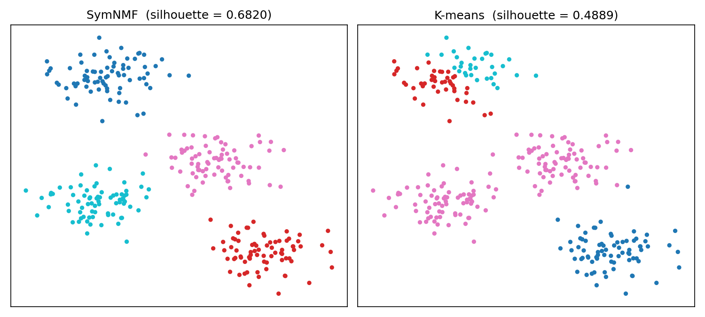

# SymNMF Clustering

Graph-based clustering with **Symmetric Non-negative Matrix Factorization**, implemented in
ANSI C with a Python C-API extension, and benchmarked against K-means.



*On the same data, K-means (initialized from the first k points) gets stuck in a local optimum
and splits one blob in two, while SymNMF recovers all four clusters.*

## Highlights

- **C core**: strict ANSI C (`-ansi -Wall -Wextra -Werror -pedantic-errors`), contiguous matrix
  storage, no memory leaks (verified with valgrind in CI).
- **Python extension**: written by hand against the CPython C API. It accepts lists or NumPy
  arrays and raises Python exceptions instead of crashing the interpreter.
- **Efficient update rule**: computes `H·Hᵀ·H` as `H·(HᵀH)`, which costs O(N·k²) per step instead
  of O(N²·k) and never allocates an N×N intermediate. Normalization costs O(N²) instead of the
  O(N³) a dense `D^-1/2·A·D^-1/2` product would take.
- **Tested**: a pytest suite checks the C and Python paths against NumPy reference implementations,
  checks the K-means baseline against scikit-learn, and covers input edge cases and error handling.

## Algorithm

Given points `x₁ … x_N ∈ ℝᵈ` and a number of clusters `k`:

| Step | Definition |
|------|------------|
| Similarity matrix `A` | `a_ij = exp(-‖x_i − x_j‖² / 2)` for `i ≠ j`, `a_ii = 0` |
| Degree matrix `D` | diagonal, `d_i = Σ_j a_ij` |
| Normalized similarity `W` | `W = D^-1/2 · A · D^-1/2` |
| Factorization | find `H ≥ 0` (N×k) minimizing `‖W − HHᵀ‖²_F` |

`H` starts with uniform random values in `[0, 2·√(mean(W)/k)]` and is refined with the
multiplicative update rule (β = 0.5):

```
H ← H ∘ (1 − β + β · (W·H) ⊘ (H·Hᵀ·H))
```

The update stops when `‖H_{t+1} − H_t‖²_F < 10⁻⁴` or after 300 iterations. Each point is then
assigned to the column of `H` with the highest score.

Reference: D. Kuang, C. Ding, H. Park, *Symmetric Nonnegative Matrix Factorization for Graph
Clustering*, SIAM SDM 2012.

## Build

Requirements: a C compiler, Python 3.9+, and the packages in `requirements.txt`.

```bash
pip install -r requirements.txt
make          # builds the ./symnmf C executable
make ext      # builds the symnmfmodule Python extension in place
make test     # builds both and runs the test suite
```

## Usage

**Python CLI**: the goal is `symnmf`, `sym`, `ddg` or `norm`.

```bash
python3 symnmf.py 4 symnmf examples/blobs_k4_d2.txt   # prints H (N×k)
python3 symnmf.py 4 norm   examples/blobs_k4_d2.txt   # prints W (N×N)
```

**C CLI**: the goal is `sym`, `ddg` or `norm`.

```bash
./symnmf sym examples/blobs_k4_d2.txt
```

**Comparison with K-means** (silhouette score, higher is better):

```bash
python3 analysis.py 4 examples/blobs_k4_d2.txt --plot comparison.png
# nmf: 0.6820
# kmeans: 0.4889
```

**As a library**:

```python
import numpy as np
from symnmf import cluster

X = np.loadtxt("examples/moons_k2_d2.txt", delimiter=",")
labels = cluster(X, k=2)
```

Input files contain one point per line, with comma-separated coordinates. All outputs use 4
decimal places. Any error prints `An Error Has Occurred` and exits with a non-zero status.

## Results

| Dataset | N | d | k | SymNMF | K-means |
|---------|---|---|---|--------|---------|
| `blobs_k4_d2` | 300 | 2 | 4 | **0.6820** | 0.4889 |
| `blobs_k5_d7` | 500 | 7 | 5 | 0.3291 | **0.4292** |
| `moons_k2_d2` | 300 | 2 | 2 | 0.4875 | **0.4878** |

The silhouette score favors compact, convex clusters, which is the shape K-means assumes, so
K-means can score higher even when SymNMF's partition is arguably the more natural one.

## Project structure

```
symnmf.h          public C API
symnmf.c          similarity / degree / normalization matrices and the SymNMF optimizer
io.c              robust CSV parsing and output formatting
main.c            C command-line interface
symnmfmodule.c    CPython extension wrapping the C library
symnmf.py         Python CLI and library entry points
analysis.py       vectorized K-means baseline, silhouette comparison and plotting
tests/            pytest suite
examples/         sample datasets and plots
```

## Background

Built as the final project of the *Software Project* course (0368-2161) at Tel Aviv University,
2024, and later refactored for performance, memory safety and testability.
